# frax-tokenized-receivables

Student org members front money for events and then wait weeks for ASUC to reimburse them. Here they get that reimbursement now, in frxUSD from a pool Frax funds on Fraxtal, and send it to Frax when ASUC pays them. Built by Blockchain at Berkeley with Frax.

Live on Fraxtal testnet: [fraxnet-college.andrewjliu22.workers.dev](https://fraxnet-college.andrewjliu22.workers.dev)

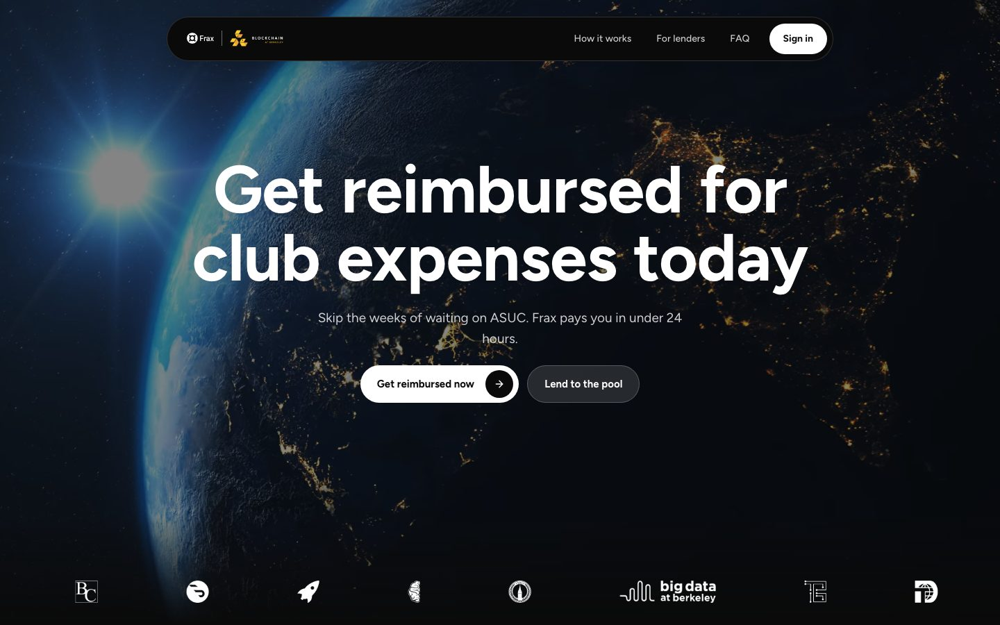

Where things stand and what's blocked: [STATUS.md](STATUS.md).

The first live use is Blockchain at Berkeley's hackathon on October 11, 2026, on Fraxtal mainnet with real frxUSD. The preview above is Fraxtal testnet, where we rehearse it. Sign-in, account setup, and onboarding work there today. Getting reimbursed needs the contracts deployed, which is waiting on the Safes (see "Before the hackathon" below). The contracts aren't audited.

## How it goes

Screenshots from one run of `pnpm --filter web readme-shots` on the local stack (September 27), walking through the hackathon. Jordan Park put $2,400 of catering on their own card, and ASUC will take weeks to reimburse it. Jordan asks to get reimbursed now, Sam Rivera signs off as a B@B officer, and a B@B underwriter approves it.

Before any of it, Jordan and Sam each connect their FraxNet account on Verification, so the app can see FraxNet has verified them. Nobody can ask for a reimbursement or sign off until then.

Jordan picks the org, the CalLink purchase request, and the amount. The panel on the right shows what they get now and what they send Frax later. Receipts and an officer's sign-off come next.

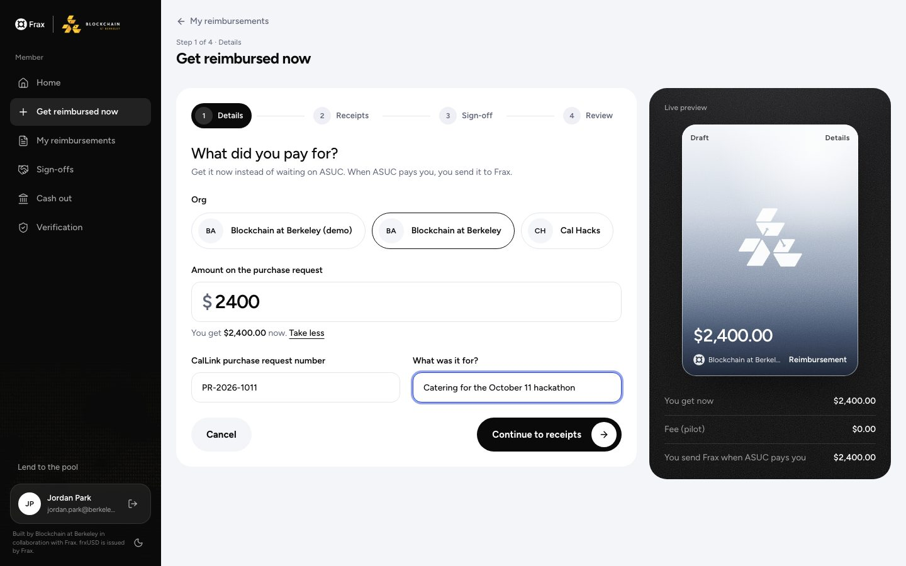

Sam gets a link and signs off on their phone. It's a signature, not a payment: Sam only covers anything if ASUC never pays.

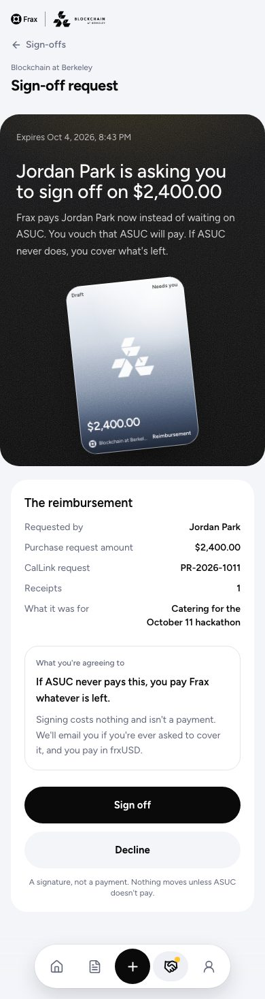

The underwriter sees the request with the receipt, both KYC results from FraxNet, and the org's exposure, then approves it. Inside the B@B Safe the buttons propose a Safe transaction instead of sending one; outside it you get a Transaction Builder file.

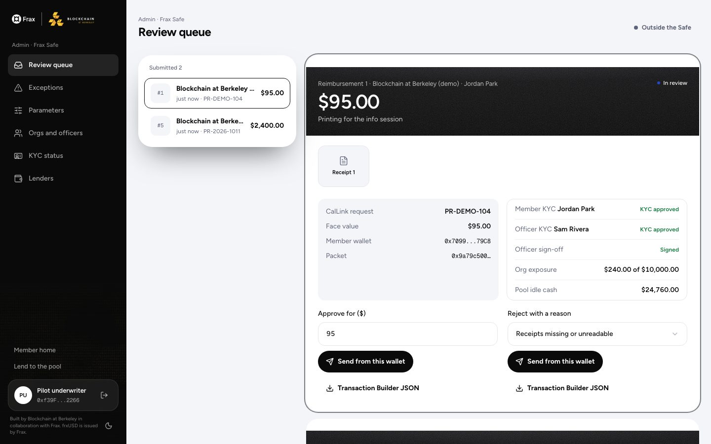

Jordan presses "Get paid". $2,400 of frxUSD lands in their wallet the same day.

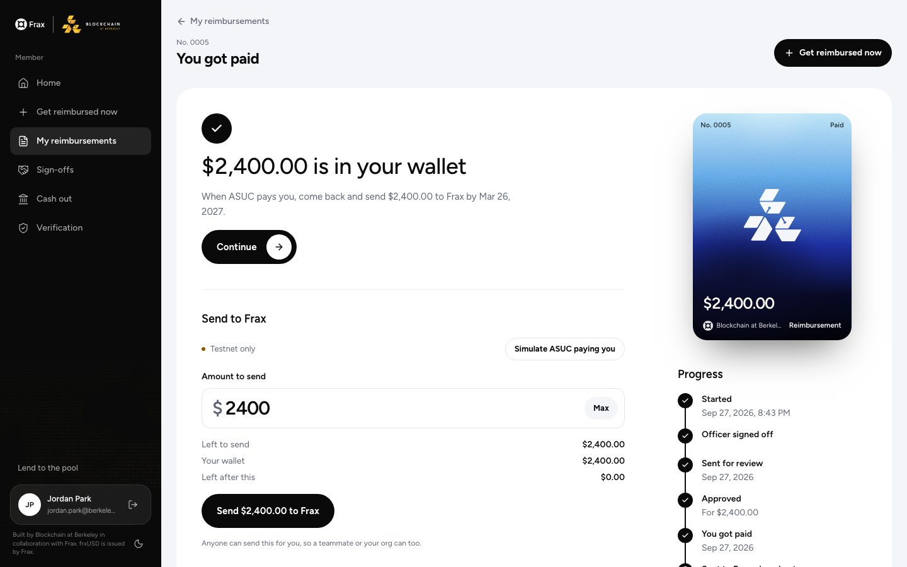

When ASUC pays Jordan, they send the $2,400 to Frax and it's closed out. Locally and on testnet a button stands in for ASUC. On mainnet it's the real reimbursement.

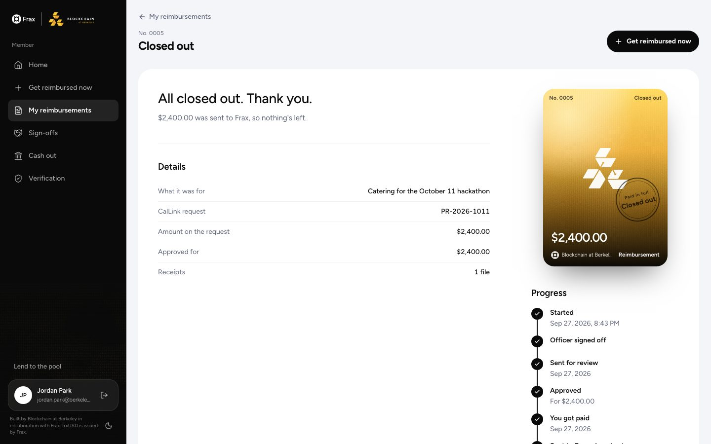

The rest of the hackathon on Jordan's home: AV and prizes paid out, T-shirts waiting for review.

<table>
<tr>
<td>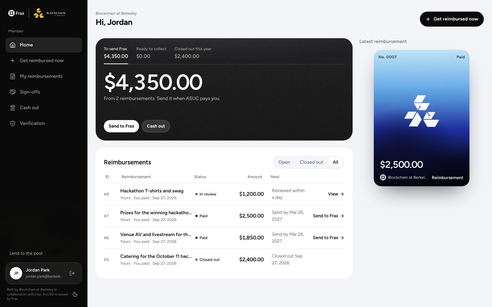</td>
<td width="240">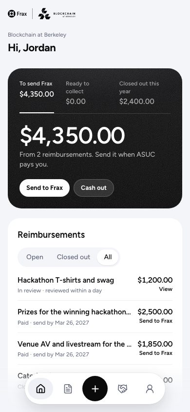</td>
</tr>
</table>

Lenders (Frax, for the hackathon) see the pool: idle cash, what's out on reimbursements, exposure by org, and recent purchases.

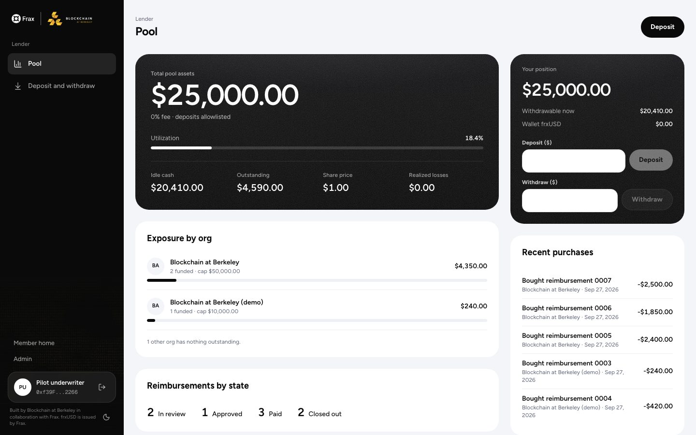

Every member- and officer-facing screen works at 375px. The e2e suite fails if any of those screens scrolls sideways. Sign-in is Google or an emailed code, with a separate tab for making an account (U-70). This one is from the hosted site, since local builds have no Privy app.

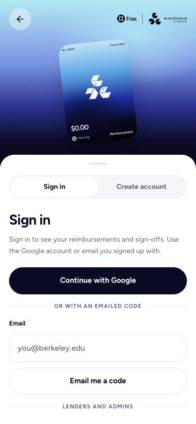

## Words

The app talks to students in plain words; the contracts and code keep the terms from the PRD. Purchase language still holds (U-09): nothing here is called a loan, and members never "repay".

| On screen | In the contracts and code |
|---|---|
| Get reimbursed now | sell a claim, `submitClaim` then `purchaseClaim` |
| reimbursement | claim |
| officer sign-off | guaranty, signed by the guarantor |
| You got paid / Paid | `Funded` |
| Send it to Frax | `settle` |
| Closed out | `Settled`, `Recovered` |
| Officer asked to cover | `GuarantorCalled` |

## Limits for the hackathon

These are the mainnet terms in `deployments/fraxtal.json`. The contracts enforce them, and the admin Safe can change them.

- $2,500 per reimbursement. A bigger bill can only get $2,500 of itself paid now, so the $10,000 target is at least four.
- $10,000 outstanding per org by default. Blockchain at Berkeley gets its own cap of $50,000, since it runs the hackathon and puts its internal receivables through here this semester. Every other org stays at $10,000 (U-69). Closing one out frees up that room again.
- The pool only has what Frax deposits, up to $50,000. Someone can only get paid if there's enough idle cash at that moment, so the hackathon needs at least $10,000 in before October 11. B@B's cap is the whole pool, so underwriters have to leave room for other orgs by hand.
- 100% of the approved amount is paid out and there's no fee yet (U-08). When there is one, it's a yearly rate on what hasn't been sent back yet, so sending it back sooner costs less (U-84). Approval lapses after 14 days if nobody presses "Get paid". Members have 180 days after getting paid to send Frax the ASUC payment. After that the attester can ask the officer to cover it, and write it off 60 days later.
- The contracts aren't audited and nothing is upgradeable. If something goes wrong, the pauser stops new purchases and deposits, while sending to Frax and withdrawing stay open ([RUNBOOK](docs/RUNBOOK.md), "Pause in an emergency").

The admin orgs page shows each org's cap. B@B's is the custom one:

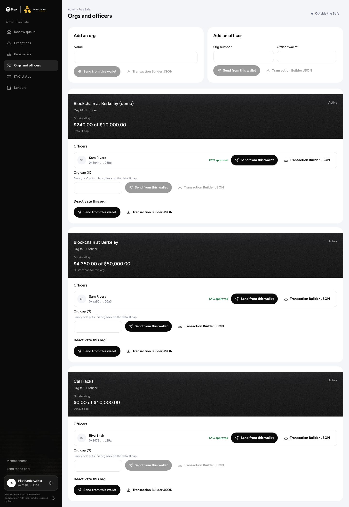

## Run it locally

Needs Node 24, pnpm 10, Foundry 1.8.3, Docker, the Supabase CLI (2.117.0), and Deno 2.

To click around, `pnpm install` then `pnpm local`. It starts anvil, Supabase, and the edge functions, seeds a member with a reimbursement in each state plus an officer, a lender, and an underwriter, and serves the site on http://localhost:3000. The sign-in screen lists those demo people, since local builds have no Privy app. Details are under "Click around locally" in [docs/RUNBOOK.md](docs/RUNBOOK.md) (U-62).

To run the tests by hand, with anvil in its own terminal:

```bash
pnpm install
anvil
(cd contracts && NETWORK=local forge script script/Deploy.s.sol --rpc-url http://127.0.0.1:8545 --broadcast)
supabase start
(cd contracts && forge test)
pnpm test
pnpm functions:test
pnpm e2e
```

`pnpm e2e` builds the site for `local`, serves the edge functions with a throwaway Privy test key, and runs the Playwright suite in `apps/web/e2e` against anvil, local Supabase, and the mock adapters. It covers a claim from wizard to settled, approval through a stand-in Safe UI and through a Transaction Builder file, ASUC rejecting and the guarantor paying, a lender depositing and withdrawing, and onboarding. Every screen gets saved at 375px and 1440px in `apps/web/e2e/screenshots`.

The README screenshots come from `pnpm --filter web readme-shots` (`apps/web/e2e/readme.tour.ts`), except the phone sign-in, which is the hosted site. Run it on a fresh anvil after `supabase db reset`, or the org list fills up with test orgs. If receipt uploads start failing with a 500 after a reset, `supabase stop --no-backup && supabase start` fixes the storage schema.

Other checks CI runs: `pnpm lint`, `pnpm typecheck`, `forge coverage --report summary`, `slither .` and `aderyn .` in `contracts/`, `supabase test db`, and actionlint. See `.github/workflows/ci.yml`.

## Hosting

The preview is the static export in `apps/web/out` served as an assets-only Cloudflare Worker (`wrangler.jsonc`), with the backend on Supabase project `thrroafmcnkjagkqhfjg`. It deploys by hand for now:

```bash
NEXT_PUBLIC_NETWORK=fraxtal-testnet NEXT_PUBLIC_SUPABASE_URL=... NEXT_PUBLIC_SUPABASE_ANON_KEY=... NEXT_PUBLIC_PRIVY_APP_ID=... pnpm --filter web build
npx wrangler@4 deploy
```

Deploy-on-push to main is one click away once a BerkeleyBlockchain owner approves the Cloudflare GitHub app. The values and the steps are in the "Hosted preview" section of [docs/RUNBOOK.md](docs/RUNBOOK.md).

## Layout

```
contracts/          Foundry: ClaimRegistry, ReceivablesPool, ClaimNFT, OrgRegistry, MockFrxUSD, Deploy.s.sol
deployments/        one JSON per network, read by the deploy script, the functions, and the site
packages/config     @app/config, the zod schema and loader for deployments/*.json
packages/abi        @app/abi, ABIs generated from contracts/out
packages/adapters   @app/adapters: FraxNet, gas sponsor, cash-out, chain reader, each with a mock
supabase/           Postgres migrations, private receipt storage, and the edge functions
apps/web            Next.js static export: claimant, guarantor, lender, and admin Safe App pages
scripts/            uncertainties.mjs (the open-questions list for Frax) and local-demo.ts (demo people) and local-up.sh (`pnpm local`)
docs/screenshots    the images in this README
```

## Docs

- [docs/PRD.md](docs/PRD.md): what to build and why, with requirement IDs and invariants. The source of truth.
- [docs/SYSTEM_DESIGN.md](docs/SYSTEM_DESIGN.md): contracts, storage, functions, routes
- [docs/UNCERTAINTIES.md](docs/UNCERTAINTIES.md): every call Frax hasn't confirmed, U-01 to U-75. The bottom section is the list to send Frax in one message.
- [docs/RUNBOOK.md](docs/RUNBOOK.md): local setup, the hosted preview, the Fraxtal testnet deploy step by step, then what changes for mainnet
- [docs/BRAND.md](docs/BRAND.md): co-branding rules and voice. The look itself now follows the landing page (U-75).
- [docs/GOALS.md](docs/GOALS.md): the done condition for each build phase
- [docs/reference/FraxNet_Project_Overview.pdf](docs/reference/FraxNet_Project_Overview.pdf): the original scope from B@B and Frax
- [contracts/SECURITY.md](contracts/SECURITY.md): roles, what each could do if compromised, trust assumptions
- [contracts/audits/static-analysis.md](contracts/audits/static-analysis.md): Slither and Aderyn triage. Raw Aderyn output is [contracts/audits/aderyn-report.md](contracts/audits/aderyn-report.md).
- [contracts/audits/coverage.md](contracts/audits/coverage.md): coverage numbers and the gaps outside `src/`
- [CLAUDE.md](CLAUDE.md): working rules for this repo: Solidity and TypeScript conventions, purchase language, what never to do

## Before the hackathon

Mainnet, by October 10:

- Three 2-of-3 Safes on Fraxtal mainnet, their addresses in `deployments/fraxtal.json`, then Andrew runs the deploy.
- From Frax: at least $10,000 of real frxUSD deposited, the partner API base URL (or agreement that underwriters confirm KYC by hand), and the Frax Mesh address for cash-out (or cash-out waits). `fraxtal.json` won't load without the last two (U-68).
- The admin Safe sets B@B's cap to $50,000 right after adding the org.
- A production Privy app, a mainnet Supabase project, and a mainnet Worker. The testnet ones stay for rehearsals.
- Frax hasn't signed off on the co-branded look yet (U-38, U-65).

Testnet, for the dry run:

- `deployments/fraxtal-testnet.json` still has `SET_AFTER_SAFE_CREATED` for every role, so the deploy script refuses to run there until the testnet Safes exist (RUNBOOK steps 2 and 3).
- The testnet pool uses Frax's real test frxUSD, which had zero supply on 2026-09-24. Only Frax's Safe can mint it, so Frax has to send some before anyone can get paid (U-67).
- Privy is in development mode, capped at 150 users.
