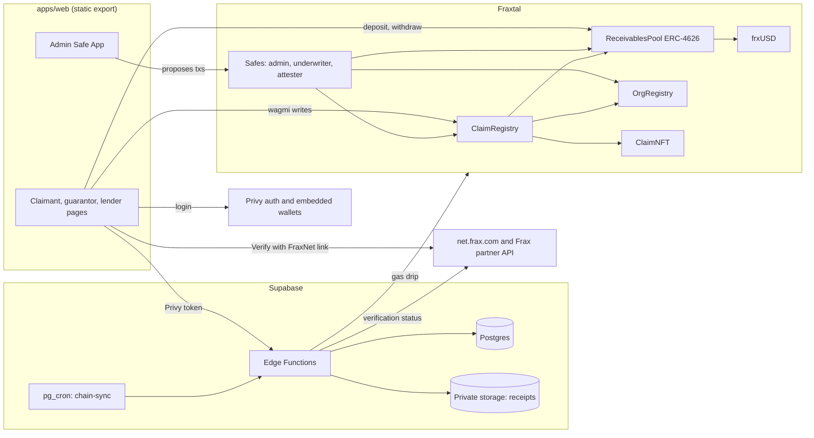

# System design: College org financing on FraxNet

This document says how to build what `docs/PRD.md` specifies. If the two disagree, the PRD wins. Log the conflict in `docs/UNCERTAINTIES.md`. Open decisions are marked with their `U-xx` ID.

## 1. Architecture



- Money and claim state live onchain. Supabase holds documents, profiles, drafts, KYC status mirrors, and a status cache for emails.
- The browser never talks to Postgres directly. Every read and write goes through an edge function that checks the caller's Privy token.
- Users complete KYC on https://net.frax.com. Our app only reads the result (U-36).

## 2. Contracts

All in `contracts/src`. Solidity `0.8.28`, `evm_version = "shanghai"` (U-35), OpenZeppelin Contracts v5.

### 2.1 Shared types: `libraries/ClaimTypes.sol`

```solidity
enum ClaimState { None, Submitted, Approved, Funded, GuarantorCalled, Settled, Recovered, WrittenOff, Rejected, Cancelled }
enum RecipientType { Member, OrgTreasurer }
enum CallReason { None, AsucRejected, PartialShortfall, Overdue }

struct Claim {
    // slot packing is a suggestion; keep fields and meaning
    uint64 orgId;
    RecipientType recipientType;
    ClaimState state;
    CallReason callReason;
    uint16 feeBps;                 // snapshot at purchase
    bool principalWrittenOff;
    address recipient;             // wallet that submitted and gets paid
    address guarantor;
    uint128 faceValue;             // amount on the CalLink purchase request
    uint128 requestedAmount;
    uint128 approvedAmount;
    uint128 purchasePrice;         // equals approvedAmount at purchase
    uint128 amountDue;             // purchasePrice + fee, fee rounded up
    uint128 amountPaid;
    uint128 writtenOffPrincipal;
    bytes32 packetHash;
    uint40 submittedAt;
    uint40 approvalExpiresAt;
    uint40 purchasedAt;
    uint40 dueAt;
    uint40 guarantorCalledAt;
    uint40 writeOffEligibleAt;
}

struct Params {
    uint16 advanceRateBps;         // <= 10_000
    uint16 feeBps;                 // <= 10_000
    uint128 perClaimCap;
    uint128 perOrgCap;
    uint32 overdueWindow;          // seconds
    uint32 approvalExpiry;         // seconds
    uint32 writeOffGrace;          // seconds
}

struct SubmitClaimParams {
    uint64 orgId;
    RecipientType recipientType;
    address guarantor;
    uint128 faceValue;
    uint128 requestedAmount;
    bytes32 packetHash;
}
```

Custom errors live here too, for example `InvalidState(uint256 claimId, ClaimState current)`, `NotRecipient()`, `OrgInactive(uint64 orgId)`, `NotOfficer(uint64 orgId, address account)`, `GuarantorIsRecipient()`, `InvalidGuaranty()`, `GuarantyExpired()`, `AmountExceedsLimit(uint256 amount, uint256 limit)`, `ApprovalExpired()`, `OrgCapExceeded(uint64 orgId, uint256 outstanding, uint256 cap)`, `InsufficientIdleCash(uint256 needed, uint256 available)`, `NotOverdue()`, `WriteOffTooEarly()`, `PacketAlreadyUsed(bytes32 packetHash)`, `ZeroAmount()`, `InvalidParams()`, `OnlyRegistry()`, `RegistryAlreadySet()`, `LenderNotAllowed(address)`, `DepositCapExceeded()`, `TransfersDisabled()`.

### 2.2 `OrgRegistry.sol`

Access: `DEFAULT_ADMIN_ROLE` only for writes.

```solidity
function addOrg(string calldata name) external returns (uint64 orgId);   // ids start at 1
function setOrgActive(uint64 orgId, bool active) external;
function setOfficer(uint64 orgId, address officer, bool active) external;
function isActiveOrg(uint64 orgId) external view returns (bool);
function isActiveOfficer(uint64 orgId, address account) external view returns (bool);
function orgName(uint64 orgId) external view returns (string memory);

event OrgAdded(uint64 indexed orgId, string name);
event OrgActiveSet(uint64 indexed orgId, bool active);
event OfficerSet(uint64 indexed orgId, address indexed officer, bool active);
```

### 2.3 `ClaimRegistry.sol`

Inherits `AccessControl`, `Pausable`, `ReentrancyGuard`, `EIP712`, `Nonces`.

Roles: `DEFAULT_ADMIN_ROLE`, `UNDERWRITER_ROLE`, `ATTESTER_ROLE`, `PAUSER_ROLE`.

EIP-712 domain: name `"FraxCollegeClaimRegistry"`, version `"1"`.

```solidity
bytes32 constant GUARANTY_TYPEHASH = keccak256(
  "Guaranty(address guarantor,address recipient,uint64 orgId,uint128 faceValue,uint128 requestedAmount,bytes32 packetHash,uint256 nonce,uint256 deadline)"
);
```

Functions:

```solidity
// claimant
function submitClaim(SubmitClaimParams calldata p, uint256 deadline, bytes calldata guarantySig) external returns (uint256 claimId);
function cancelClaim(uint256 claimId) external;
function purchaseClaim(uint256 claimId) external;

// anyone
function settle(uint256 claimId, uint256 amount) external returns (uint256 paid);

// underwriter
function approveClaim(uint256 claimId, uint128 amount) external;
function rejectClaim(uint256 claimId, bytes32 reasonCode) external;

// attester
function callGuarantor(uint256 claimId, CallReason reason) external;
function writeOff(uint256 claimId) external;

// admin and pauser
function setParams(Params calldata newParams) external;   // admin
function pause() external;                                 // pauser
function unpause() external;                               // admin

// views
function getClaim(uint256 claimId) external view returns (Claim memory);
function claimCount() external view returns (uint256);
function params() external view returns (Params memory);
function orgOutstanding(uint64 orgId) external view returns (uint256);
function amountRemaining(uint256 claimId) external view returns (uint256);
function isOverdue(uint256 claimId) external view returns (bool);
function isApprovalExpired(uint256 claimId) external view returns (bool);
function guarantyDigest(address guarantor, address recipient, uint64 orgId, uint128 faceValue, uint128 requestedAmount, bytes32 packetHash, uint256 nonce, uint256 deadline) external view returns (bytes32);
function nonces(address owner) external view returns (uint256);
```

Rules by function, beyond PRD section 7:

- `submitClaim`: `recipient = msg.sender`. Checks org active, guarantor active officer, `guarantor != msg.sender` (U-34), treasurer type requires `msg.sender` to be an officer, `requestedAmount > 0`, `requestedAmount <= faceValue * advanceRateBps / 10_000`, `requestedAmount <= perClaimCap`, `packetHash` unused, `block.timestamp <= deadline`, and `SignatureChecker.isValidSignatureNow(guarantor, digest, sig)` using `_useNonce(guarantor)`. Marks the packet hash used. Claim IDs start at 1.
- `approveClaim`: `0 < amount <= requestedAmount`, `amount <= perClaimCap`. Sets `approvalExpiresAt = now + approvalExpiry`.
- `purchaseClaim`: caller is the recipient, state `Approved`, not expired, org active, `orgOutstanding + amount <= perOrgCap`, `pool.idleCash() >= amount`. Effects: snapshot `feeBps`, set `purchasePrice`, `amountDue = purchasePrice + ceil(purchasePrice * feeBps / 10_000)`, `purchasedAt`, `dueAt = now + overdueWindow`, increase `orgOutstanding`, state `Funded`. Interactions: `nft.mint(address(pool), claimId)`, then `pool.fundPurchase(recipient, purchasePrice)`.
- `settle`: state `Funded`, `GuarantorCalled`, or `WrittenOff`. Works while paused. `paid = min(amount, amountDue - amountPaid)`, reverts on 0. Principal portion is `min(paid, purchasePrice - principalPaidSoFar)`, where principal is paid first. If the claim is not written off, reduce `orgOutstanding` by the principal portion and call `pool.recordPrincipalReturned(principalPortion)`. Then `frxUSD.safeTransferFrom(msg.sender, address(pool), paid)`. On full payment: `Funded` goes to `Settled`; `GuarantorCalled` and `WrittenOff` go to `Recovered`.
- `callGuarantor`: state `Funded`. `Overdue` requires `block.timestamp >= dueAt`. Sets `writeOffEligibleAt = now + writeOffGrace`.
- `writeOff`: state `GuarantorCalled` and `block.timestamp >= writeOffEligibleAt`. `unpaid = purchasePrice - principalPaid`. Reduce `orgOutstanding` by `unpaid`, call `pool.realizeLoss(unpaid)`, set `principalWrittenOff = true`, `writtenOffPrincipal = unpaid`, state `WrittenOff`.
- `setParams`: `advanceRateBps <= 10_000`, `feeBps <= 10_000`, caps > 0, windows > 0. Emits old and new values.

Events:

```solidity
event ClaimSubmitted(uint256 indexed claimId, uint64 indexed orgId, address indexed recipient, address guarantor, RecipientType recipientType, uint128 faceValue, uint128 requestedAmount, bytes32 packetHash);
event ClaimCancelled(uint256 indexed claimId);
event ClaimApproved(uint256 indexed claimId, uint128 amount, uint40 approvalExpiresAt);
event ClaimRejected(uint256 indexed claimId, bytes32 reasonCode);
event ClaimPurchased(uint256 indexed claimId, address indexed recipient, uint128 purchasePrice, uint128 amountDue, uint16 feeBps, uint40 dueAt);
event ClaimSettlementPaid(uint256 indexed claimId, address indexed payer, uint256 paid, uint256 principalPortion, uint256 amountRemaining);
event ClaimSettled(uint256 indexed claimId);
event GuarantorCalled(uint256 indexed claimId, address indexed guarantor, CallReason reason, uint256 amountRemaining, uint40 writeOffEligibleAt);
event ClaimRecovered(uint256 indexed claimId);
event ClaimWrittenOff(uint256 indexed claimId, uint256 principalLost);
event ParamsUpdated(Params oldParams, Params newParams);
```

Reject reason codes are `bytes32` strings the admin app picks from a fixed list: `MISSING_RECEIPTS`, `NOT_REIMBURSABLE`, `DUPLICATE`, `KYC_NOT_APPROVED`, `OVER_LIMIT`, `OTHER`.

### 2.4 `ReceivablesPool.sol`

Inherits `ERC4626`, `AccessControl`, `ReentrancyGuard`. Name `"B@B x Frax College Pool"`, symbol `"bbfCP"`. `_decimalsOffset()` returns `6`.

```solidity
function setRegistry(address registry) external;              // admin, once
function setLenderAllowed(address lender, bool allowed) external;   // admin
function setAllowlistEnabled(bool enabled) external;          // admin
function setDepositCap(uint256 cap) external;                 // admin

function fundPurchase(address to, uint256 amount) external;   // registry only
function recordPrincipalReturned(uint256 amount) external;    // registry only
function realizeLoss(uint256 amount) external;                // registry only

function totalAssets() public view override returns (uint256); // balance + outstandingPrincipal
function idleCash() external view returns (uint256);           // asset balance
function outstandingPrincipal() external view returns (uint256);
function totalLosses() external view returns (uint256);
function maxDeposit(address) public view override returns (uint256);  // 0 if paused or not allowed; else cap room
function maxMint(address) public view override returns (uint256);
function maxWithdraw(address owner) public view override returns (uint256); // min(owner assets, idleCash)
function maxRedeem(address owner) public view override returns (uint256);

event RegistrySet(address registry);
event LenderAllowedSet(address indexed lender, bool allowed);
event AllowlistEnabledSet(bool enabled);
event DepositCapSet(uint256 cap);
event PurchaseFunded(address indexed to, uint256 amount);
event PrincipalReturned(uint256 amount);
event LossRealized(uint256 amount);
```

- Deposits are blocked when `ClaimRegistry.paused()` is true. The pool reads the registry's pause state so one pause covers both (U-26).
- "Total deposits" for the cap means `totalAssets()`, so realized losses and settlements free or use cap room naturally.
- `fundPurchase` transfers frxUSD out and increases `outstandingPrincipal`. `recordPrincipalReturned` decreases it. `realizeLoss` decreases it and increases `totalLosses`.

### 2.5 `ClaimNFT.sol`

`ERC721("B@B x Frax College Claim", "bbfCLAIM")`, `AccessControl`.

```solidity
function setRegistry(address registry) external;    // admin, once
function mint(address to, uint256 claimId) external; // registry only
function setBaseURI(string calldata uri) external;  // admin; points at the nft-metadata function
```

Override `_update` so any transfer where `from != address(0)` reverts with `TransfersDisabled()` (U-19).

### 2.6 `mocks/MockFrxUSD.sol`

`ERC20("Mock frxUSD", "frxUSD")`, 18 decimals, `mint(address,uint256)` open to anyone. Only deployed when config `frxUSD` is `null`.

### 2.7 Deploy script: `script/Deploy.s.sol`

1. Read `deployments/$NETWORK.json` with `vm.readFile` and `vm.parseJson`.
2. If `isTestnet` is false and any role equals `SET_AFTER_SAFE_CREATED`, revert. If `frxUSD` is `null` and `isTestnet` is false, revert.
3. Deploy `MockFrxUSD` if `frxUSD` is `null`.
4. Deploy `OrgRegistry`, `ClaimNFT`, `ReceivablesPool`, `ClaimRegistry` with the deployer as temporary admin.
5. Wire: `pool.setRegistry`, `nft.setRegistry`, `nft.setBaseURI`, pool deposit cap and allowlist from params.
6. Grant roles to the config addresses (on `local`, the deployer). Grant `PAUSER_ROLE` to both the admin Safe and `emergencyPauser`.
7. On every network except `local`, the deployer renounces all its roles.
8. Write addresses and the deployment block into `deployed` in the same JSON with `vm.writeJson`.

## 3. Network config

Full schema, extending the example in PRD section 10. Validated by `packages/config` with zod.

```ts
type NetworkConfig = {
  network: 'local' | 'fraxtal-testnet' | 'sepolia' | 'fraxtal';
  chainId: number;
  isTestnet: boolean;
  rpcUrl: string;
  explorer: string | null;
  safeUi: string | null;                 // https://safe.testnet.frax.com
  gasFaucet: string | null;              // https://faucet.testnet.frax.com
  frxUSD: `0x${string}` | null;          // null deploys MockFrxUSD
  fraxnet: {
    appUrl: string;                      // https://net.frax.com
    apiBase: string | null;              // Frax partner API, null until shared (U-36)
  };
  fraxMesh: `0x${string}` | null;        // OFT contract for Fraxtal to Ethereum, mainnet cash-out (U-17)
  cashOutSink: `0x${string}` | null;     // testnet simulated cash-out destination
  roles: { admin: string; underwriter: string; attester: string; emergencyPauser: string };
  params: {
    advanceRateBps: number; perClaimCap: string; perOrgCap: string; poolDepositCap: string;
    feeBps: number; overdueWindowSeconds: number; approvalExpirySeconds: number;
    writeOffGraceSeconds: number; lenderAllowlistEnabled: boolean;
  };
  adapters: {
    fraxnet: 'real' | 'mock';
    gasSponsor: 'drip' | 'mock';
    cashOut: 'mesh' | 'simulated';
    chainReader: 'rpc' | 'goldsky';
  };
  features: { simulateAsucPayout: boolean };
  deployed: {
    block?: number; frxUSD?: string; orgRegistry?: string; claimRegistry?: string;
    pool?: string; claimNft?: string;
  };
};
```

The zod schema also enforces: `simulateAsucPayout` requires `isTestnet`; `cashOut: 'mesh'` requires `fraxMesh`; `cashOut: 'simulated'` requires `cashOutSink`; `fraxnet: 'real'` requires `fraxnet.apiBase`.

## 4. Adapters: `packages/adapters`

Written in plain TypeScript with no Node-only APIs, so both the web app and Deno edge functions can import them. Each folder exports an interface, a `real` implementation, a `mock` implementation, and a `create<Name>(config)` factory.

```ts
export type VerificationStatus = 'not_started' | 'pending' | 'approved' | 'rejected';

export interface FraxNetClient {
  verifyUrl(): string;   // config.fraxnet.appUrl
  getVerificationStatus(wallet: Address): Promise<{
    status: VerificationStatus;
    kind?: 'individual' | 'business';
    approvedAt?: string;
  }>;
  getLiquidationAddress(wallet: Address): Promise<Address | null>;
}

export interface GasSponsor {
  ensureGas(wallet: Address): Promise<{ funded: boolean; txHash?: Hash; reason?: 'above_threshold' | 'rate_limited' | 'no_profile' }>;
}

export interface CashOut {
  simulated: boolean;
  buildTransfer(p: { from: Address; amount: bigint; liquidationAddress: Address }): Promise<Array<{ to: Address; data: Hex; value: bigint }>>;
}

export interface ChainReader {
  getPoolStats(): Promise<{ totalAssets: bigint; idleCash: bigint; outstandingPrincipal: bigint; totalLosses: bigint; totalSupply: bigint; sharePrice: bigint }>;
  getClaim(id: bigint): Promise<ClaimView>;
  listClaims(filter: { recipient?: Address; guarantor?: Address; orgId?: bigint; states?: ClaimState[] }): Promise<ClaimView[]>;
  getOrgExposure(): Promise<Array<{ orgId: bigint; name: string; outstanding: bigint; cap: bigint }>>;
  getClaimEvents(id: bigint): Promise<ClaimEvent[]>;
}
```

| Adapter | `real` / production | `mock` / testnet |
|---|---|---|
| FraxNetClient | `real`: calls `fraxnet.apiBase`. Throws `NotAvailableError` for anything Frax hasn't documented (U-36, U-37) | `mock`: statuses from an in-memory map, settable from tests and from the admin manual-status function |
| GasSponsor | `drip`: viem wallet client with `DRIP_PRIVATE_KEY`; sends `DRIP_AMOUNT_WEI` of FRAX when balance is below `DRIP_THRESHOLD_WEI` | `mock`: always reports funded |
| CashOut | `mesh`: builds approve and OFT send calls to `fraxMesh`, destination the Ethereum liquidation address | `simulated`: builds one frxUSD transfer to `cashOutSink` |
| ChainReader | `goldsky`: GraphQL against the subgraph (mainnet) | `rpc`: viem multicall for state and `getLogs` from `deployed.block` |

## 5. Backend: Supabase

### 5.1 Tables (`supabase/migrations`)

Addresses are stored lowercase. Token amounts are `numeric(78,0)` in wei.

| Table | Columns | Notes |
|---|---|---|
| `profiles` | `wallet_address` pk, `privy_user_id` unique, `email`, `display_name`, `kyc_status` (`not_started`, `pending`, `approved`, `rejected`), `kyc_source` (`fraxnet_api`, `manual`), `kyc_updated_by`, `kyc_updated_at`, `fraxnet_account_ref`, `liquidation_address`, `created_at` | One per wallet |
| `staff` | `wallet_address` pk, `role` (`underwriter`, `attester`, `admin`) | Who can use admin functions offchain; onchain roles are still enforced by the Safes |
| `orgs` | `id` pk (matches onchain `orgId`), `name`, `active`, `created_at` | Mirrors `OrgRegistry` |
| `org_officers` | `org_id`, `wallet_address`, `title`, `active`, pk (`org_id`, `wallet_address`) | Mirrors `OfficerSet` |
| `claims` | `id` uuid pk, `onchain_claim_id` unique null, `org_id`, `recipient_wallet`, `recipient_type`, `face_value`, `requested_amount`, `callink_pr_number`, `description`, `packet_json`, `packet_hash`, `guarantor_wallet`, `guaranty_signature`, `guaranty_nonce`, `guaranty_deadline`, `status_cache`, `asuc_outcome` (`none`, `rejected`, `short_paid`), `asuc_outcome_note`, `created_at`, `updated_at`; unique (`org_id`, `callink_pr_number`) | The unique constraint blocks selling the same purchase request twice |
| `claim_documents` | `id` uuid, `claim_id`, `storage_path`, `sha256`, `mime_type`, `size_bytes`, `uploaded_by`, `created_at` | Files live in the `receipts` bucket |
| `guarantor_invites` | `id` uuid, `claim_id`, `guarantor_wallet`, `token_hash`, `expires_at`, `used_at` | Token is random; only its hash is stored |
| `gas_drips` | `id`, `wallet_address`, `amount_wei`, `tx_hash`, `created_at` | Rate limit: one per wallet per 24 hours |
| `admin_actions` | `id`, `actor_wallet`, `action`, `target`, `payload` jsonb, `created_at` | Audit log for manual KYC and other offchain admin actions |
| `notifications` | `id`, `wallet_address`, `kind`, `claim_id`, `sent_at` | Prevents duplicate emails |
| `sync_state` | `key` pk, `last_block` | Cursor for `chain-sync` |

- Row level security is on for every table with no policies for `anon` or `authenticated`, so direct access is denied. Edge functions use the service role after checking the caller.
- Storage bucket `receipts` is private. Functions hand out short-lived signed URLs after checking access: the claimant, the org's active officers, and staff.

### 5.2 Edge functions (`supabase/functions`)

Every function except `nft-metadata` and `fraxnet-webhook` requires `Authorization: Bearer <Privy access token>`, verified with `jose` against `PRIVY_VERIFICATION_KEY` and `PRIVY_APP_ID`. The wallet in the request must belong to that Privy user.

| Function | Method | Who | Does |
|---|---|---|---|
| `me` | GET, POST | Any user | Returns profile, staff role, officer orgs. POST upserts profile from the Privy token |
| `kyc-status` | POST | Any user | Refreshes status through `FraxNetClient`, updates profile, returns status and `verifyUrl` |
| `kyc-manual` | POST | Staff underwriter | Sets a wallet's status with a note; writes `admin_actions` (U-36) |
| `fraxnet-webhook` | POST | FraxNet | Only if Frax provides webhooks. Verifies HMAC SHA-256 with `FRAXNET_WEBHOOK_SECRET`, updates status |
| `claims` | GET, POST, PATCH | Claimant, officers, staff | Create and edit drafts, list, get one with documents |
| `documents` | POST | Claimant | Returns a signed upload URL; after upload, records `sha256` |
| `documents-read` | POST | Claimant, officers, staff | Returns a signed read URL |
| `packet` | POST | Claimant | Freezes the draft into canonical JSON (RFC 8785), computes `keccak256`, stores it, returns `packetHash` and the EIP-712 typed data for the guaranty |
| `guarantor-invite` | POST, GET | Claimant; guarantor | POST creates an invite and emails it. GET resolves a token into the claim summary |
| `guaranty` | POST | Guarantor | Checks the signature with viem `verifyTypedData`, stores it |
| `gas-drip` | POST | Any user with a profile | Calls `GasSponsor.ensureGas` and logs to `gas_drips` |
| `report-outcome` | POST | Claimant | Records `ASUC rejected` or `ASUC paid less` with a note |
| `simulate-payout` | POST | Claimant | Testnet only: mints mock frxUSD equal to the amount due. Refuses when `isTestnet` is false |
| `nft-metadata` | GET | Public | `/nft-metadata/{claimId}`: state, org name, amounts, dates. No personal data |
| `chain-sync` | POST | pg_cron every minute | Reads new logs through `ChainReader`, updates `status_cache`, `orgs`, `org_officers`, links `onchain_claim_id` by `packetHash`, sends emails |

Emails go through Resend (`RESEND_API_KEY`) for the triggers in PRD FR-B9.

## 6. Frontend: `apps/web`

Next.js App Router, `output: 'export'`, Tailwind, shadcn/ui themed from `docs/BRAND.md`, Privy (`@privy-io/react-auth` with `@privy-io/wagmi`), wagmi, viem, TanStack Query.

### 6.1 Routes

| Route | Who | Content |
|---|---|---|
| `/` | Everyone | Co-branded landing, one-line pitch, "Sell a claim" button, testnet banner |
| `/onboard` | New users | Login, then "Verify with FraxNet" (opens https://net.frax.com in a new tab) showing the wallet address to add in FraxNet, then "Check my status" |
| `/claims` | Claimant | My claims with state chips and amounts |
| `/claims/new` | Claimant | Wizard: org, who paid, amount and CalLink number, receipts, guarantor, review, submit |
| `/claim?id=` | Claimant, guarantor, officers | Status timeline and the one action for the current state |
| `/guarantee?invite=` | Guarantor | Claim summary, plain-language obligation, sign |
| `/lend` | Lender | Stats, deposit, withdraw, exposure by org, claims table |
| `/admin` | Staff, inside Safe | Review queue |
| `/admin/exceptions` | Staff | Overdue and reported claims; call guarantor; write off |
| `/admin/params` | Staff | Current and proposed params side by side |
| `/admin/orgs` | Staff | Orgs and officers |
| `/admin/lenders` | Staff | Lender allowlist, deposit cap |
| `/admin/kyc` | Staff | Manual verification status with notes (U-36) |

### 6.2 Actions by claim state (on `/claim`)

| State | Claimant sees | Guarantor sees |
|---|---|---|
| Draft (offchain) | Finish claim, invite guarantor, submit once signed | Sign |
| `Submitted` | Waiting for review, cancel | Waiting |
| `Approved` | "Get paid $X" with expiry countdown | Waiting |
| `Funded` | Due date, "Settle," "Report ASUC outcome," "Cash out," testnet "Simulate ASUC payout" | Nothing owed |
| `GuarantorCalled` | Amount remaining, "Settle" | Amount owed, "Settle" |
| `Settled`, `Recovered` | Done | Done |
| `WrittenOff` | Amount remaining, "Settle" | Amount owed, "Settle" |
| `Rejected`, `Cancelled` | Reason, start a new claim | Nothing owed |

### 6.3 Write path

1. Call `gas-drip` if the wallet's FRAX balance is below the threshold.
2. For token spends (`settle`, `deposit`), check allowance and send `approve` first if needed.
3. Send the contract call with wagmi, wait for the receipt, then invalidate the TanStack Query keys for that claim and the pool.

### 6.4 Safe App

- `apps/web/public/manifest.json` with name, description, and icon so the admin pages load inside Frax's Safe UI (U-27).
- Uses `@safe-global/safe-apps-sdk` to propose transactions. Outside a Safe, shows "Open in Frax Safe" and a Transaction Builder JSON download.
- The host must send CORS headers for `manifest.json`. `docs/RUNBOOK.md` notes this for Frax's hosting (U-21).

## 7. Main sequences

### Submit a claim

1. Claimant creates a draft (`claims`), uploads receipts (`documents`).
2. `packet` freezes the draft and returns `packetHash` and guaranty typed data. The nonce is read from `ClaimRegistry.nonces(guarantor)`.
3. `guarantor-invite` emails the guarantor. The guarantor signs on `/guarantee`, and `guaranty` stores the signature.
4. Claimant calls `submitClaim(params, deadline, signature)`.
5. `chain-sync` sees `ClaimSubmitted`, links `onchain_claim_id` by `packetHash`.

If the guarantor's nonce changes before submission (they signed for another claim first), the signature is stale. The app detects the mismatch and asks the guarantor to sign again.

### Purchase and settle

1. Underwriter's Safe executes `approveClaim`.
2. Claimant presses "Get paid," the app calls `purchaseClaim`.
3. Later the claimant calls `settle`, after "Simulate ASUC payout" on testnet or a FraxNet virtual account deposit on mainnet.

## 8. Testnet vs mainnet

| | Fraxtal testnet (MVP) | Fraxtal mainnet (later) |
|---|---|---|
| frxUSD | Frax test frxUSD, or `MockFrxUSD` (U-25) | `0xfc00000000000000000000000000000000000001` |
| Gas | Drip funded from faucet.testnet.frax.com | Drip funded by Frax, or Frax's chosen method (U-05) |
| KYC | Real on net.frax.com; status by API or manual | Real on net.frax.com; status by API |
| Cash-out | `simulated` to `cashOutSink` | `mesh` to the user's liquidation address |
| Settlement funding | `simulate-payout` | FraxNet virtual account |
| Indexing | `rpc` | `goldsky` |
| Admin | safe.testnet.frax.com | safe.mainnet.frax.com |

## 9. Environment variables

| Variable | Used by | Notes |
|---|---|---|
| `NETWORK` | Contracts, functions | Picks `deployments/<NETWORK>.json` |
| `NEXT_PUBLIC_NETWORK` | Web | Same, for the browser |
| `NEXT_PUBLIC_PRIVY_APP_ID` | Web | |
| `NEXT_PUBLIC_SUPABASE_URL` | Web | Functions base URL |
| `NEXT_PUBLIC_SUPABASE_ANON_KEY` | Web | Only used to call functions; tables deny it |
| `SUPABASE_SERVICE_ROLE_KEY` | Functions | Never in the browser |
| `PRIVY_APP_ID`, `PRIVY_VERIFICATION_KEY` | Functions | Token verification |
| `DRIP_PRIVATE_KEY`, `DRIP_AMOUNT_WEI`, `DRIP_THRESHOLD_WEI` | `gas-drip` | Small balance only |
| `FRAXNET_API_KEY`, `FRAXNET_WEBHOOK_SECRET` | Functions | Empty until Frax shares them |
| `RESEND_API_KEY`, `EMAIL_FROM` | Functions | |
| `APP_BASE_URL` | Functions | For links in emails |

Local development uses anvil's default funded accounts. No real key ever goes in a file.
